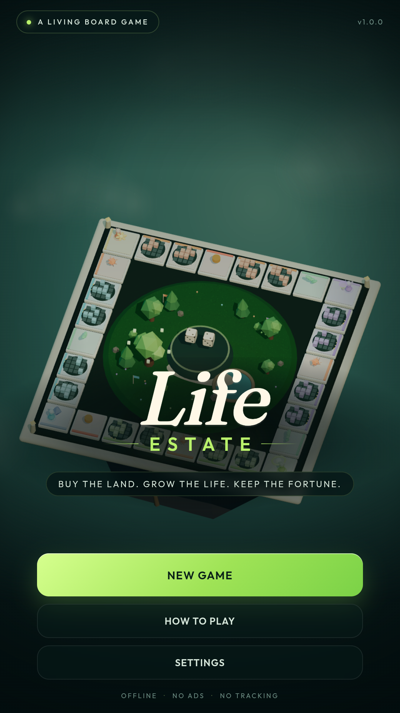
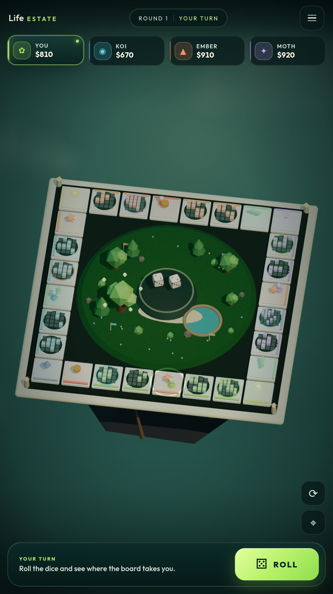
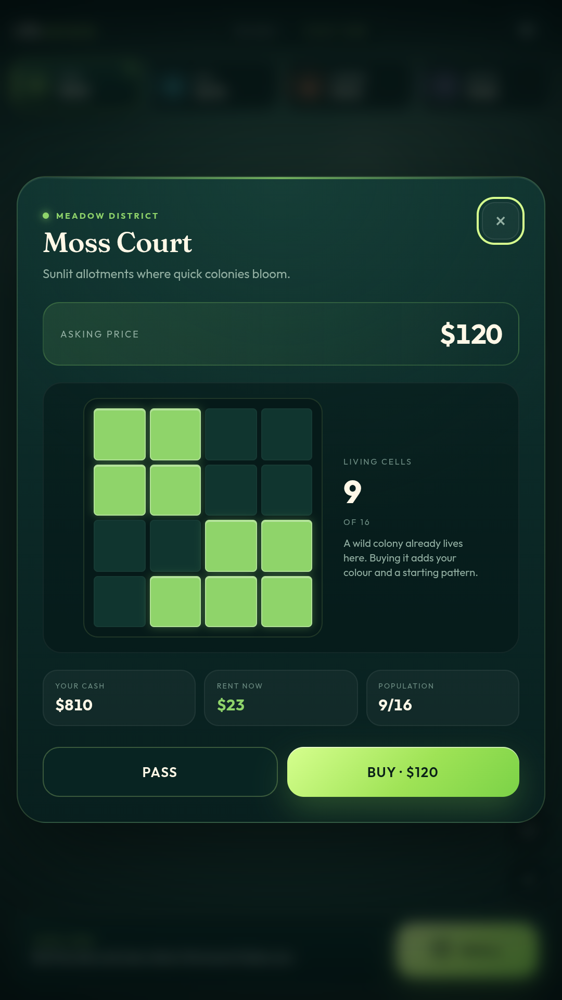

# Life Estate

**A 3D board game where every property is alive.**

Life Estate is an original Android board game that blends property trading with a
cellular-life simulation. Each of the 16 properties runs its own colony on a
toroidal grid. Population drives rent, upgrades expand the grid from 4×4 to 6×6,
and the first estate to **$5,000 net worth** wins.

<p align="center">
  
  
  
</p>

## What is in the box

- A floating island board with 28 handcrafted tiles
- 16 living colonies with populations, rent, seeding, harvesting, and three upgrade levels
- Three AI rivals with cozy, sharp, and ruthless personalities
- 22 mutation and ecosystem cards
- Local saves, synthesized WebAudio, haptics, and a responsive portrait UI
- A native Android WebView shell with no internet permission, no ads, and no tracking

The game is an original work. It is not affiliated with, endorsed by, or sponsored
by any other board game publisher.

## Play in a browser

```bash
npm ci
npm run dev
```

Open <http://localhost:3002>. The board supports mouse, touch, pinch zoom, and
drag rotation. Press `Escape` to open the pause menu.

## Test and build

```bash
npm test                 # 13 rules and life-engine tests
npm run sim -- 400 sharp # headless balance simulation
npm run build            # production bundle in dist/
npm run preview          # serve the production bundle
```

## Android

Requirements: Node 20+, JDK 17, Android SDK 36.

```bash
npm run android:debug    # debug APK
npm run android:key      # create upload key (once)
npm run android:bundle   # signed release AAB
```

Outputs:

```
android/app/build/outputs/apk/debug/app-debug.apk
android/app/build/outputs/apk/release/app-release.apk
android/app/build/outputs/bundle/release/app-release.aab
```

The wrapper uses `WebViewAssetLoader` to serve the Vite bundle from a secure local
origin. The release manifest requests only `VIBRATE`. Full instructions, signing
steps, versioning, and a device smoke test live in [docs/RELEASE.md](docs/RELEASE.md).

## Play Store

- Store copy, content rating, and Data Safety answers: [docs/STORE_LISTING.md](docs/STORE_LISTING.md)
- Privacy policy: [docs/privacy-policy.html](docs/privacy-policy.html)
- Listing artwork: `store/output/`
- Regenerate artwork from the real game: `npm run store:capture`

Before uploading, replace `YOUR_DEVELOPER_NAME` and `YOUR_EMAIL_HERE` in the
privacy policy and Play Console contact fields.

## Project layout

```
src/game/            rules, board data, Conway life engine, AI, saves
src/render/          Three.js scene, textures, WebAudio synth
src/ui/              HUD, modals, interactions, haptics
src/main.js          boot, presenter adapters, lifecycle hooks
android/             native WebView shell, adaptive icons, Gradle build
tests/               node:test suites
scripts/             balance sim, asset sync, store capture, upload key
docs/                release guide, listing kit, privacy policy
store/               artwork sources and generated Play assets
```

## CI

`.github/workflows/ci.yml` runs the test suite, builds the web bundle, and produces
a debug APK artifact. `.github/workflows/pages.yml` publishes the privacy policy
from `docs/` when GitHub Pages is enabled.

---

<!-- omgithub:readme:start -->
## 🚀 Build, play, and remix with OMGithub

**Remixed using [OMGithub.com](https://omgithub.com).**

[](https://omgithub.com/Ffenuss/LifeIsAGame)
[](https://github.com/Ffenuss/LifeIsAGame)

- 🎮 [Open the project](https://omgithub.com/Ffenuss/LifeIsAGame).
- ✨ [Remix this project](https://omgithub.com/?remix=Ffenuss%2FLifeIsAGame).
- 💻 [Explore the source](https://github.com/Ffenuss/LifeIsAGame).
- 🛠️ [Check build runs](https://github.com/Ffenuss/LifeIsAGame/actions).
- 🐛 [Report an issue](https://github.com/Ffenuss/LifeIsAGame/issues).
- 👤 [Explore the creator's projects](https://omgithub.com/Ffenuss).
- 🌍 [Create with OMGithub](https://omgithub.com).
- 🧬 [Explore the remix source](https://github.com/Ffenuss/LifeIsAGame).
<!-- omgithub:readme:end -->
